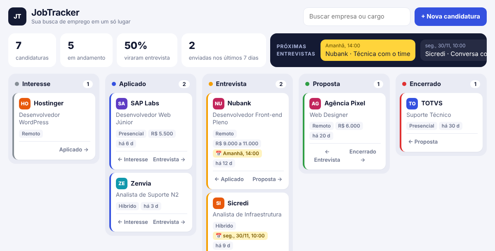

# JobTracker — Candidaturas a vagas

Acompanhe candidaturas a vagas em um quadro com status, datas de entrevista, contato do recrutador e anotações.

🔗 **[Ver o site no ar](https://iamviniciuslima05.github.io/PROJETO-JobTracker/)**



## Funcionalidades

- Quadro com colunas **Interesse, Aplicado, Entrevista, Proposta e Encerrado**
- **Arrastar e soltar** entre colunas (e botões para mover no celular)
- **Data e etapa da entrevista**
- **Contato do recrutador**: nome, e-mail, telefone e LinkedIn
- Salário, modelo de trabalho, link da vaga e **anotações**
- Painel de **próximas entrevistas**
- Estatísticas: em andamento, taxa de entrevista e envios da semana
- Busca por empresa ou cargo

## Tecnologias

HTML5 · CSS3 · JavaScript · Drag and Drop API · localStorage

## Estrutura

```
index.html
css/style.css
js/script.js
```

## Como rodar

Não precisa instalar nada: baixe o projeto e abra o `index.html` no navegador, ou acesse a versão publicada acima.

---
Feito por **Vinicius Lima** · [Portfólio](https://viniciuslimadev.netlify.app) · [LinkedIn](https://www.linkedin.com/in/viniciuslima25/)
